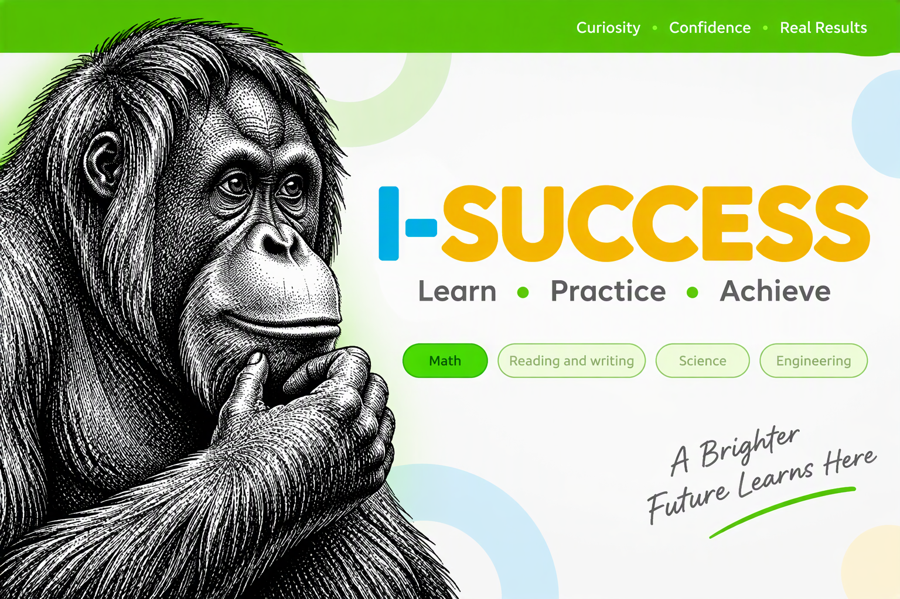

# I-SUCCESS



Adaptive practice for every grade, from Pre-K to university, rebuilt in pure Rust.

Pick a subject, open a level, choose a grade and practise its skills one problem at a time:
type an answer, check it, and open the worked steps when you are stuck. Math comes first.

Status: early. The first release has math skills for Pre-K to grade 4; the other levels and
subjects are shown and say they are not built yet.

## Run it

You need Rust (the version is pinned in `rust-toolchain.toml`; `rustup` installs it).

```bat
.\run.cmd           build and run the app (Windows)
.\run.cmd ci        every check: format, lint, tests
.\run.cmd coverage  line coverage, with its floor
```

On any platform:

```bash
cargo run --release -p i-success
cargo xtask ci
git config core.hooksPath .githooks   # once per clone: checks on commit and push
```

Contributing: start with [`AGENTS.md`](AGENTS.md) and the guides in [`SKILLS/`](SKILLS/README.md)
(code guide, developer experience, content, UI).

## How it is built

A Cargo workspace of small crates, in layers:

| Crate | Job |
|---|---|
| `crates/model` | Subjects, level bands, grades, skills, problems. No UI, no files. |
| `crates/content` | Reads and checks the catalog in `content/catalog.toml`, embedded at build time. |
| `crates/engine` | Checks answers (numbers within a tolerance, or text) and runs a practice session. |
| `crates/ui-egui` | The window, drawn with egui: the top bar, the home screen and the practice screen. |
| `apps/i-success` | The desktop app. |
| `xtask` | `cargo xtask ci` and its parts. |

Practice content lives in `content/catalog.toml`. Every problem is original and labelled by
where its answer comes from; the content tests check that every worked step leads to an
accepted answer.

`SKILLS/study-wb` is the early proof of concept in JavaScript: offline practice pages built from
content files. `.\run.cmd poc` opens its examples.

## Licence

MIT OR Apache-2.0, at your option. The artwork in `assets/brand/` is not covered by that licence;
see `ATTRIBUTION.md` and `NOTICE`.
